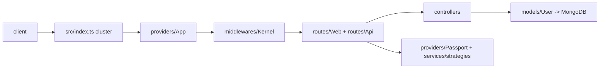

# Architecture

## Request flow
`src/index.ts` starts a Node cluster: the master process loads configuration and forks one
worker per CPU. Each worker builds the Express app (`src/providers/Express.ts`, started from
`src/providers/App.ts`), mounts the middleware kernel (`src/middlewares/Kernel.ts`) and then the
route files through `src/providers/Routes.ts` (web routes first, then API routes).

## Layers
- **routes/** map URLs to controllers only (`Web.ts` for pages, `Api.ts` for JSON).
- **controllers/** hold request handling; API controllers live under `controllers/Api/`.
- **models/** are Mongoose models; **interfaces/** hold the TypeScript types.
- **providers/** wire infrastructure: database, cache, queue, Passport, locals/config.
- **middlewares/** are cross-cutting: CORS, CSRF, logging, static files, status monitor.
- **exception/** handles uncaught errors and process/cluster events.

## Where to put new code
New endpoints: a controller plus one line in the right route file. New infrastructure: a provider.
Controllers must not import other controllers.
